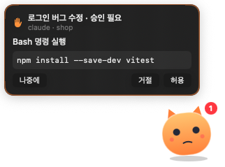
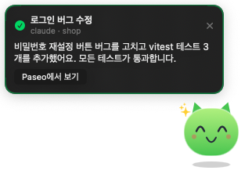

# Paseo Pet

[English](README.md) · **한국어**

[Paseo](https://paseo.sh)용 데스크톱 펫입니다. 화면 구석에 떠 있다가 에이전트 상태에 따라 반응하고, 작업이 끝나거나 실패하면 알려 줍니다. 권한 요청은 Paseo를 열지 않고 펫에서 바로 허용/거절할 수 있습니다.

<p>
  
  
</p>

| 폴더 | 내용 |
| --- | --- |
| `plugin/` | **pet-bridge**: 에이전트 이벤트를 로컬 SSE API로 내보내는 Paseo 플러그인 |
| `app/` | **PaseoPet**: 펫을 그리는 macOS 메뉴바 앱 |

## 동작 방식

```
Paseo 데몬 ─ lifecycle hooks ─▶ pet-bridge (127.0.0.1:6792, 토큰 인증 SSE)
                                      │  turn 시작/종료, 실패, 권한 요청/해결
                                      ▼
                              PaseoPet.app (메뉴바 + 항상 위 투명 창)
                                      │  허용/거절 → POST → SDK respondToPermission
```

- 플러그인 hook은 **앱 창이 없어도 데몬에서 실행**되므로 Paseo 창을 닫아 둬도 알림이 옵니다.
- 펫 상태: 💤 연결 대기(보라) · 쉬는 중(민트) · 작업 중(파랑, 통통 튐 + 톱니) · 승인 대기(주황, 흔들림 + 배지) · 완료(초록, 점프 + 반짝이) · 실패(회색, 시무룩)
- 말풍선
  - 완료: 마지막 답변 요약과 "Paseo에서 보기" 버튼
  - 실패: 오류 메시지
  - 권한 요청: 실행할 명령과 **허용 / 거절 / 나중에** 버튼. 질문 유형이면 "Paseo에서 답하기" 버튼이 대신 나옵니다.
- 펫이나 말풍선을 클릭하면 `paseo://h/<serverId>/agent/<agentId>` 딥링크로 해당 에이전트 화면이 바로 열립니다.
- Paseo가 맨 앞에 있을 때는 펫이 숨습니다(메뉴에서 끌 수 있음). 펫은 드래그로 옮길 수 있고, 위치는 기억됩니다.
- 보안: 127.0.0.1에만 바인딩합니다. 플러그인이 시작될 때마다 새 토큰을 `~/.paseo/pet-bridge/connection.json`(0600)에 기록합니다. 브라우저 요청(Origin 헤더가 있는 요청)은 거부합니다.
- 하위 에이전트(subagent)의 완료 알림은 생략합니다. 오케스트레이션 중에는 너무 많이 쌓이기 때문입니다.

## 펫 모양 바꾸기 (스킨)

메뉴바 🐾 → **스킨 → 스킨 폴더 열기**를 누르면 `~/Library/Application Support/PaseoPet/Skins/`가 열립니다. 이 안에 폴더 하나가 스킨 하나이고, 상태별 이미지를 아래 이름으로 넣으면 됩니다.

| 파일 이름 | 표시되는 때 |
| --- | --- |
| `idle` | 쉬는 중 (필수에 가까움, 다른 상태 이미지가 없으면 이걸 씀) |
| `working` | 에이전트 작업 중 |
| `waiting` | 승인 대기 |
| `happy` | 작업 완료 직후 몇 초 |
| `sad` | 작업 실패 |
| `sleeping` | Paseo 연결 끊김 |

- 확장자는 `.gif`(애니메이션 재생), `.png`, `.jpg`, `.heic`, `.webp`를 쓸 수 있습니다. 투명 배경 PNG나 GIF를 권장하고, 크기는 정사각형 256px 정도면 충분합니다(84pt로 표시).
- 기본으로 상태에 따라 통통 튀거나 흔들리는 효과가 붙습니다. GIF처럼 자체 애니메이션이 있으면 `skin.json`에 `{ "motion": false }`를 넣어 끄세요.
- 파일을 넣거나 바꾼 뒤 **스킨 → 스킨 다시 불러오기**를 누르면 바로 반영됩니다. **기본 캐릭터**를 고르면 원래 모양으로 돌아갑니다.

### Codex Pet 사용하기

[codex-pets.net](https://codex-pets.net)의 펫(8열 스프라이트 아틀라스, `pet.json` + `spritesheet.webp`)을 그대로 쓸 수 있습니다.

- 메뉴바 🐾 → **스킨 → Codex Pet 가져오기…**에 펫 페이지 주소(예: `https://codex-pets.net/#/pets/uu-usagi`)를 붙여 넣으면, 내려받아 설치하고 바로 적용합니다.
- 또는 내려받은 `*.codex-pet.zip`의 압축을 스킨 폴더 아래에 풀어도 됩니다.
- 상태별로 쓰는 행은 다음과 같습니다: 쉬는 중·연결 끊김 → `idle`, 작업 중 → `running`, 승인 대기 → `waiting`, 완료 → `jumping`, 실패 → `failed`.

- 펫 그림의 저작권은 각 작가에게 있으며, 이 저장소에는 포함하지 않습니다.

## 설치

요구 사항: macOS 14 이상, Paseo 0.11.2 이상, Xcode Command Line Tools(앱 빌드용)

```bash
# 1) Settings → Plugins → "Enable plugins" 켜기
#    (또는 ~/.paseo/config.json에 "pluginsEnabled": true 추가 후 `paseo reload`)

# 2) 브리지 플러그인 설치
paseo plugin install npm:paseo-pet-bridge        # 또는 github:me0w2en/paseo-pet:plugin
paseo plugin ls            # pet-bridge가 running인지 확인

# 3) 앱 빌드 → 원하는 위치로 옮겨 실행
git clone https://github.com/me0w2en/paseo-pet.git
paseo-pet/app/scripts/build-app.sh
cp -R paseo-pet/app/build/PaseoPet.app ~/Applications/
open ~/Applications/PaseoPet.app
# 로그인 시 자동 실행: 시스템 설정 → 일반 → 로그인 항목에 PaseoPet.app 추가
```

메뉴바 🐾 → **연결 테스트**를 누르면 펫이 "펫 브리지 연결이 정상입니다" 말풍선을 띄웁니다.

플러그인을 개발할 때는 clone한 폴더에서 로컬 경로로 설치하고(`paseo plugin install "$PWD/plugin"`), `plugin/`에서 `npm install && npm run typecheck`로 타입체크한 뒤 `paseo plugin reload pet-bridge`로 반영합니다. 앱은 `app/`에서 `swift build`로 빌드합니다.

## 제거

`paseo plugin remove pet-bridge`를 실행하고, 메뉴바에서 PaseoPet을 종료한 뒤 앱을 지웁니다. 스킨은 `~/Library/Application Support/PaseoPet/`에 있습니다.

## 제약

- macOS 전용입니다(AppKit/SwiftUI).
- 이벤트는 실시간 best-effort로 전달됩니다. 펫이 꺼져 있던 동안의 이벤트는 다시 보내지 않고, 다시 연결되면 현재 상태 스냅샷만 받습니다.
- 앱은 코드 서명이 되어 있지 않습니다. 직접 빌드하거나 Gatekeeper 경고를 넘겨야 합니다.

## 라이선스

[MIT](LICENSE)
